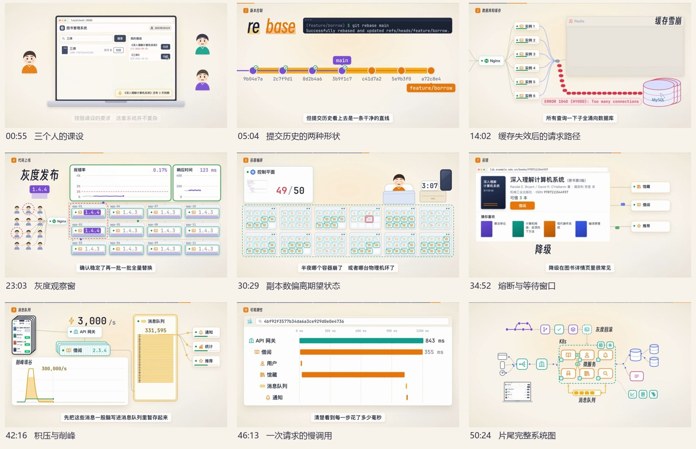

# 从三人课设到多校借阅平台

**原作**　@躺平超人《别再看面经了，我来教你点真东西》。[抖音作品](https://www.douyin.com/video/7710506054701960463) · [官方播放器](https://open.douyin.com/player/video?vid=7710506054701960463)

**核对范围**　00:00–50:25.467。取得 1920×1080、30 fps 的原作画面和 AAC 音轨，从头解码到 50:25.433 的最后一帧。全片留取 6,051 个半秒画面样本，结合 0.8 秒间隔识别的画内字幕、分段语音识别、场景图版与重点动作连续帧核对。下表为方便回看按秒取整的原片时间。图中延迟、流量、容量均是该故事的演示值。

## A　视频内容结构

贯穿全片的是同一个动作：学生找到书、登录、点借书、收到结果。从个人笔记本换到校园服务，再换到多校平台，每次先给出原方案能工作的理由，再制造它处理不了的新情形。作者穿插了两条线：**一次借书请求怎样完成**，以及**团队怎样安全地改变处理请求的软件**。

| 原片时间 | 章节 | 发生的事与它引出的下一步 |
|---|---|---|
| 00:00–01:10 | 课设起点 | 左边输入查书、借书、还书的提示词，右边秒表快进到十分钟；能运行的网站只占总图一小块。三名同学分工，浏览器、一个后端和一台 MySQL 就能完成课设。 |
| 01:10–05:57 | 01 版本控制 | 借书、还书和页面被打进名称相似的压缩包。用 commit 留快照，远程仓库同步，branch 隔开未完成功能。约 04:00 三方合并，借期 14 天与 30 天的冲突需要人选择；04:44 左右用 rebase 重放提交，随后并排看历史形状及改写公共历史的后果。 |
| 05:57–09:47 | 02 部署和扩容 | 笔记本合盖，全校失去服务；localhost 在同学机器上指向同学自己。部署到服务器后开学季 CPU 饱和。升配置、加实例、DNS 与 Nginx 入口依次出现，再比较正反向代理、轮询与加权分配、失败与超时。 |
| 09:47–18:02 | 03 数据库和缓存 | 计算实例加多后请求汇向单库。放大看 SQL 解析、索引与缓冲、锁和日志，再看主库写、从库读。11:40 左右还完书，旧副本仍显示零；13:05 左右查 Redis、未命中回源、回填与过期。接着演示击穿、穿透、雪崩、更新数据库后删缓存，及 16:30 后跨实例登录失效与共享 Session。 |
| 18:02–23:43 | 04 代码上线 | 借书判断写反并直推 main，全校借书失败。保护分支→PR/MR→评审→CI→预发布。多台机器的 Java 版本差异引出镜像和容器；用独栋与隔间解释虚拟机与共享内核。22:00 后传送带演示持续交付/部署，约 22:50 少数实例先换版，看错误率和时延决定扩大或回滚。 |
| 23:43–29:09 | 05 微服务 | 多校共用、团队扩张，一个 JAR 让发布、故障与扩容捆在一起。拆出借阅、用户、馆藏、座位、通知与搜索。座位内存耗尽时仍可借书。一次本地函数调用变为跨机调用；26:40 后将 ISBN 和天数拆成字节，比较 JSON 与 Protobuf，用一份 IDL 生成 Java/Go 类型，最后让代理执行远程扣库存。 |
| 29:09–32:56 | 06 容器编排 | 大量容器分布在机器格子上，手工重启和部署顾不过来。Kubernetes 控制平面对比期望/实际副本数，故障时从 49/50 补回，改清单可扩至 200，再滚动换版。实例重建后 IP 漂移，引出注册、健康检查、查询/订阅与中间件。 |
| 32:56–36:42 | 07 容错 | 慢 SQL 占住用户服务，借阅线程格继而变满，外层出现 504。拆一遍调用路径：选址、复用连接、超时、有限重试，再用电闸讲熔断，推荐区暂时隐去说明降级。35:00 左右半开试探，随后用隔开的并发格说明舱壁隔离，最后把共性能力收进语言框架。 |
| 36:42–39:43 | 08 网关 | 网页、App、小程序若分别对接全部内部服务，连线迅速变密。入口收束到 API Gateway；上下两排区分同一服务内分流与按请求路由到不同业务。网关可做协议转换、认证、传递身份和限流；网关需要冗余，集群内调用仍要容错。 |
| 39:43–44:05 | 09 消息队列 | 借阅成功后的通知、统计和推荐延长响应。先演示同步等待约 1,280 ms，再将进程内异步与重启丢任务并置。消息队列持久接收事件，消费者按各自节奏追赶，积压吸收尖峰；约 43:25 同一消息因确认丢失重投，去重记录让通知只产生一次。 |
| 44:05–46:33 | 10 可观测性 | 学生偶发借书失败，翻遍机器代价太高。指标先揭示异常并触发值班告警，集中日志提供报错上下文。网关创建 Trace ID 并沿调用传播，展开时间条后，馆藏调用耗时约 1,003 ms，再到对应日志查扣库存超时。 |
| 46:33–49:12 | 11 服务网格 | 把故事规模外推到上万服务，跨语言通信库的升级成本变高。治理能力从业务卡移入伴生代理 Sidecar，镜头拉远成网。数据面处理真实流量，控制面分发策略；IDL 与序列化仍有应用端工作。片中示意由 1.2 ms 到 1.6 ms，并明确几十个服务的图书平台暂不值得付这笔成本。 |
| 49:12–50:25 | 收束与回看 | 镜头回到同一全图，把开发者日常工作串回评审、预发布联调和可观测性。50:10 后用灰度方案、502 页面和面试中的消息队列问题分别指回图中位置，字幕淡去后全图留到片尾。 |

## B　视觉风格与网页规范

- **纸色底与软件窗口。** 开场的白色聊天框、书目列表和秒表，随后贯穿全片的暖象牙色底、很淡的橙黄光晕，令小型 UI、终端和架构图看起来处于同一空间。网页用暖白画布、浅色窗体、细轮廓、小圆角及近距离柔影。
- **形状有语义。** 显示器和手机代表入口，白色小窗代表实例，蓝紫圆柱代表关系库，粉色键值面板代表 Redis，金黄色小格代表排队的事件。Git 主线用紫色，借还书分支用橙和青绿。常态请求是蓝色短胶囊，故障与回滚用红色，成功用绿色。线上同时保留文字、图标或形状提示。
- **字号随观看距离变化。** 大图以位置和图标表达关系；局部窗口里再出现函数名、字段号与状态。原片的中文标题较窄、粗黑，部分英文大字倾斜；代码、地址与计时使用等宽风格。原片字体文件未公开，网页匹配字形层级。
- **空间保持连续。** 左侧是请求来源，中间是入口或处理过程，右侧是存储/依赖；全图上侧另有开发发布链。原片左上角是橙色章节号，底部留讲解字幕。教学网站沿用这些位置，播放控件布置在图外。

## C　动画语言与网页规范

| 原片动作 | 画面怎样解释概念 | 网页动作 |
|---|---|---|
| 04:44–05:08 分支重放 | 老分支变淡，新提交沿主线后方重现。对照的对象始终在视野里。 | 单步推进分叉、重放和比较，每步保留共同祖先。 |
| 11:40–11:52 主从延迟、13:05–13:21 旁路读取 | 点沿线前进，库存、命中状态及数字在到达时改变。 | 只有当前路径亮起；先显示旧值，再显示同步/回填；允许冷缓存和热缓存两次运行。 |
| 22:50–23:17 灰度、30:28–30:41 自愈 | 少数卡片先变色，周边大多保持原位。曲线或期望/实际数字随结果改变。 | 给用户一个可切换的故障条件，图上呈现影响范围和回退/补齐。 |
| 34:28–35:22 熔断和隔离 | 电闸断开、等待倒计时、半开探测，再把线程格分舱。 | 可停在每个决定点，状态文字随开关和资源格同步变化。 |
| 42:08–43:03 削峰与解耦 | 到达曲线先冲高，黄色队列堆叠再回落；消费者游标各走各的。 | 事件先入队、再逐个消费；鼠标或键盘聚焦消费者时突出它与队列的关系。 |
| 46:08 慢调用、47:25–48:28 网格 | 时间条对齐到同一 Trace ID；随后另一个场景把代理从业务内部移出，从单个服务拉远到网状结构。 | 时间条用共同刻度；网格分步展示代理、数据面与控制面，下发策略与业务请求采用不同线路。 |

节奏以**概念状态**为单位。一句讲解常跨数秒，定场时保留读图时间，流点比镜头切换快，章间常退回缩略全图再展开。网页的播放时长为便于自学重新安排；暂停冻结运动与进度，单步直接抵达下一个可解释状态，慢速和减少动态模式仍保留因果顺序。

## D　网站信息架构

1. **全局视图**呈现片尾系统图，把入口、运行时业务、数据、发布、观测放回相应位置。选择一个模块可直接探索；从头学习则回到三人课设。服务网格注明为扩大规模后的选项。
2. **章视图**对应 11 个原片章节。每章给出起始故障、涉及对象、解决方法和接下来暴露的问题。开发发布链独立于在线借书路径。
3. **机制视图**让读者选一个更小的问题，例如库存陈旧、缓存未命中、CI 失败、消费者收到重复消息。点击对象可查看它是什么、保存什么、与谁交互。
4. **演示步骤**配合播放、暂停、单步、重播和倍速；可以回到本章、回全图，或按原片顺序继续。每一步以画面变化和一句中文解释对齐，首次出现保留英文术语。

## 补充、校正与推断

- **校正 · CAP。** 约 15:08 的三角把高并发、低时延和强一致与 CAP 对应起来。CAP 的结论涉及发生网络分区时，线性一致性与可用性之间的取舍。延迟和吞吐应单列讨论。要求线性一致的实现也可以使用多数派协议。[Gilbert 与 Lynch 原论文](https://groups.csail.mit.edu/tds/papers/Gilbert/Brewer6.pdf)
- **补充 · 库存与缓存。** 原片已把关键扣库存留在主库事务。实施时须防止两个事务都先读到最后一本，再分别声称借出成功。可在事务中锁记录，或采用带库存条件的更新、检查受影响行数，再写借阅记录。旁路失效策略还要考虑并发回填、删除失败和重试。[MySQL 锁定读](https://dev.mysql.com/doc/refman/8.4/en/innodb-locking-reads.html)
- **补充 · Git、RPC 与编排。** 原片用已经分叉的历史画 merge；能快进时可只移动分支引用。RPC 描述远程调用模型，HTTP 也可作为传输；Protobuf 这个例子中，删除字段后应保留其编号。原片的注册/心跳是通用发现模型；Kubernetes Service 可配合 DNS 和 EndpointSlice 获取后端列表。[Pro Git](https://git-scm.com/book/en/v2/Git-Branching-Basic-Branching-and-Merging) · [Proto3](https://protobuf.dev/programming-guides/proto3/#updating) · [Kubernetes Service](https://kubernetes.io/docs/concepts/services-networking/service/)
- **补充 · 消息与副作用。** 原片已说明至少一次投递和消费去重。另一个故障窗口在借阅记录提交与消息发出之间。事务发件箱让业务更新和待发事件一起落库，再独立转发；下游仍需幂等。外部通知若支持幂等键，应把相同键传给通知渠道。[事务发件箱模式](https://docs.aws.amazon.com/prescriptive-guidance/latest/cloud-design-patterns/transactional-outbox.html)
- **补充 · 网格重试。** 代理可以调节超时与重试，业务端仍需判断一次借书是否已生效，必要时按请求标识去重。图中的时延差、熔断阈值、告警门槛均为教学场景的取值。[Istio 流量管理](https://istio.io/latest/docs/concepts/traffic-management/#retries)
- **设计推断。** 把章间“拉远—聚焦”转成点击下钻，把原片的成功与失败路径转成可选择的情境，是对原作教学动作的交互化解释。网站中的控件、模块边界和步长均属于这次改编。
